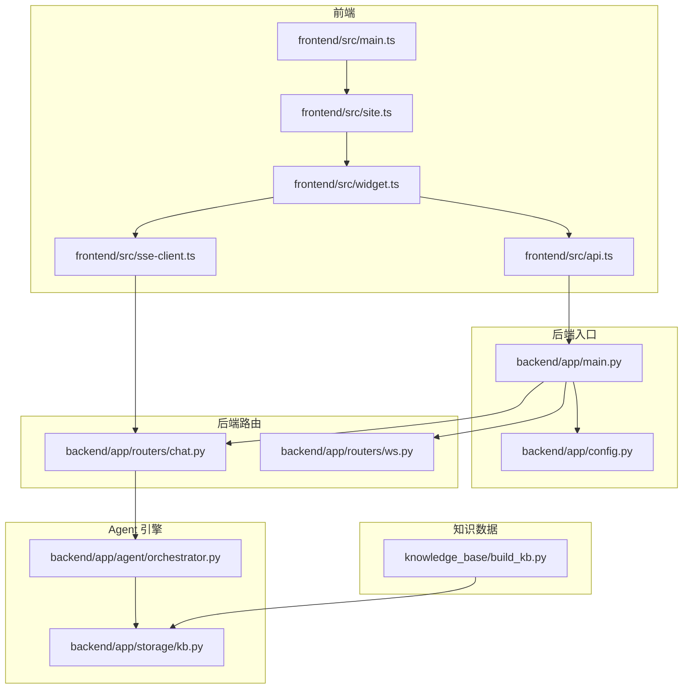
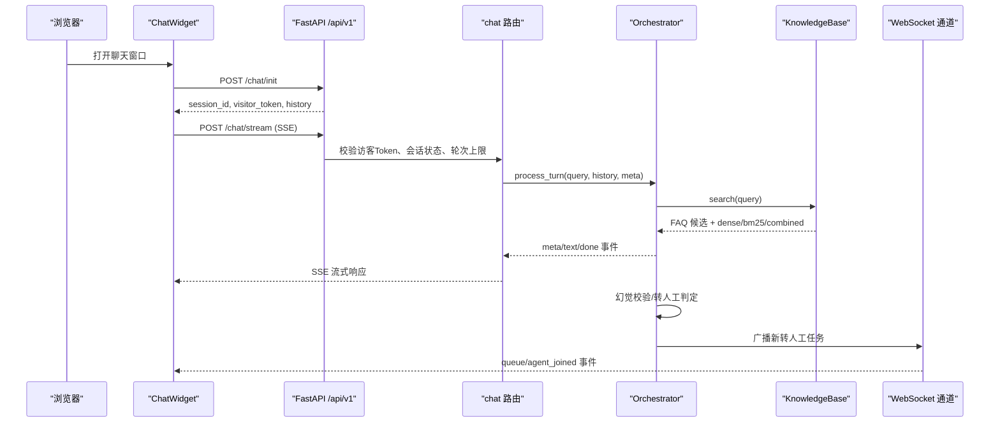
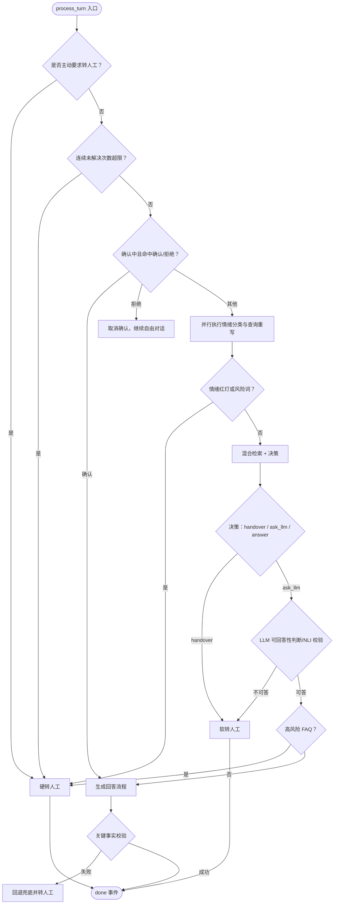
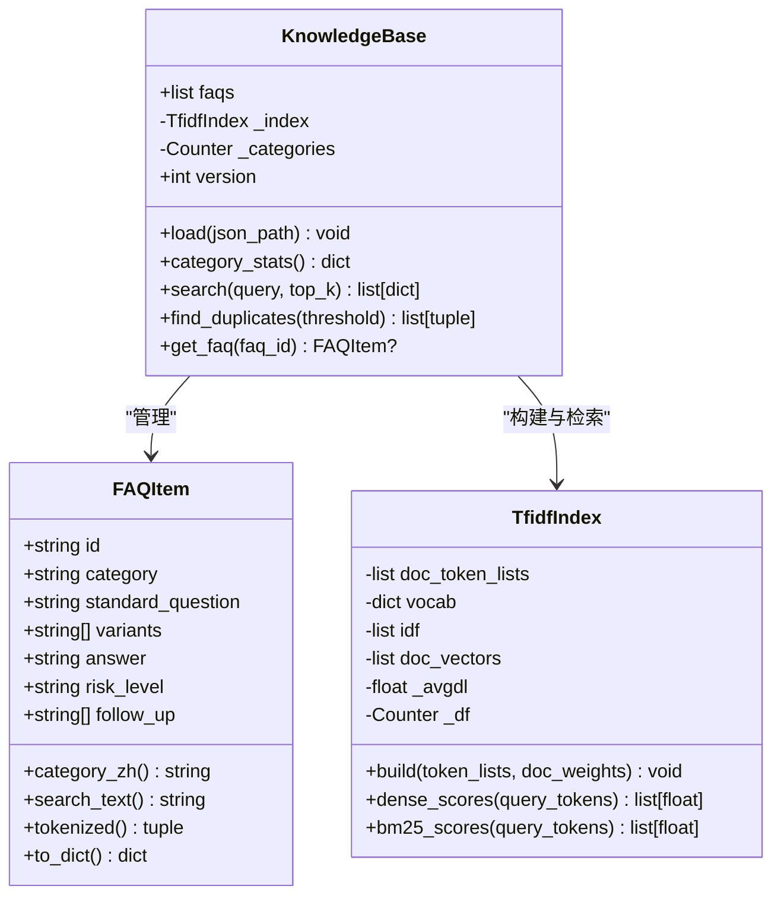
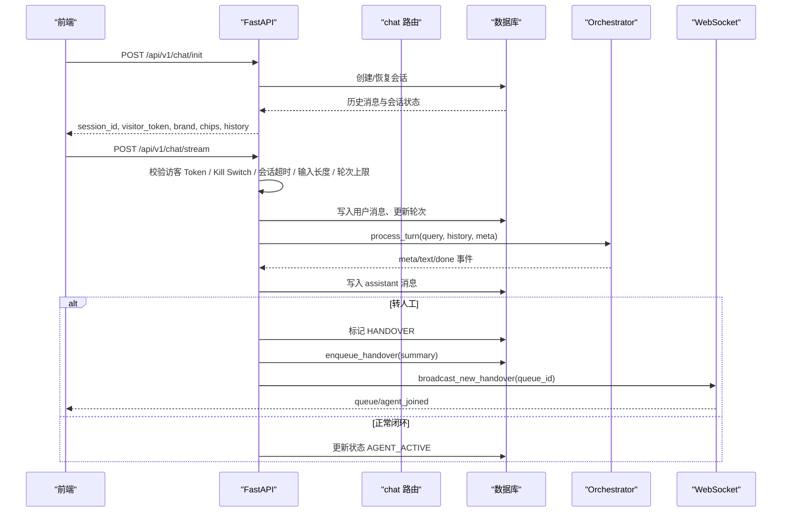
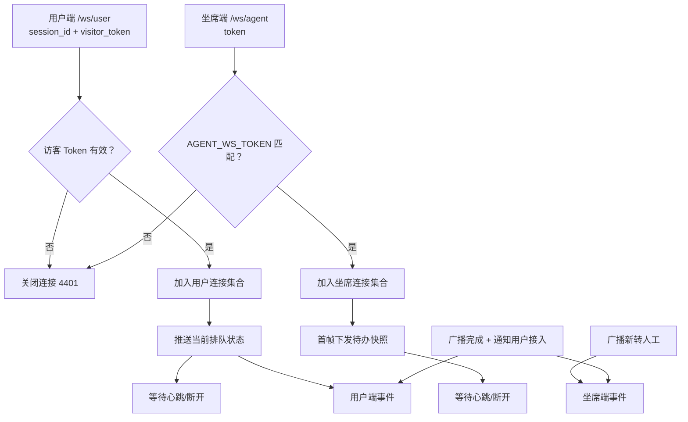
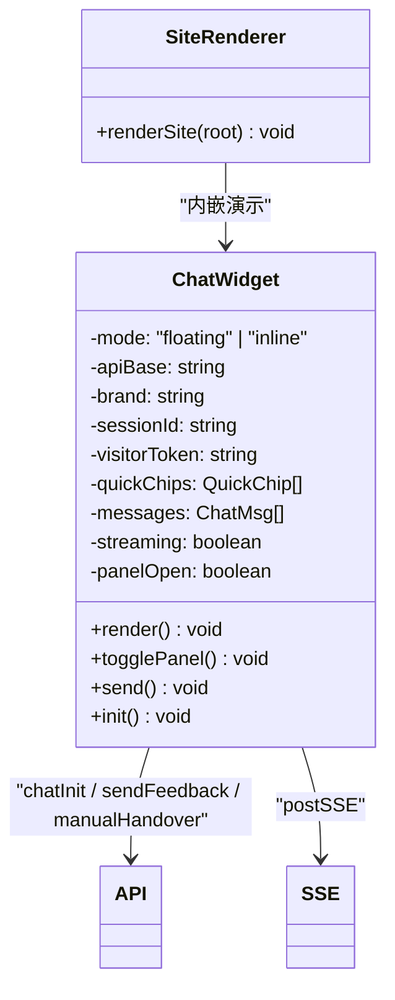
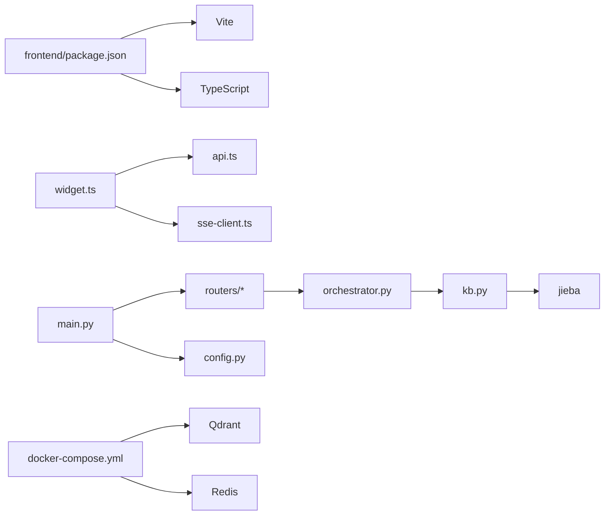

# 项目概述

<cite>
**本文引用的文件**   
- [backend/app/main.py](file://backend/app/main.py)
- [backend/app/config.py](file://backend/app/config.py)
- [backend/app/agent/orchestrator.py](file://backend/app/agent/orchestrator.py)
- [backend/app/storage/kb.py](file://backend/app/storage/kb.py)
- [backend/app/routers/chat.py](file://backend/app/routers/chat.py)
- [backend/app/routers/ws.py](file://backend/app/routers/ws.py)
- [frontend/src/main.ts](file://frontend/src/main.ts)
- [frontend/src/site.ts](file://frontend/src/site.ts)
- [frontend/src/widget.ts](file://frontend/src/widget.ts)
- [frontend/src/sse-client.ts](file://frontend/src/sse-client.ts)
- [frontend/src/api.ts](file://frontend/src/api.ts)
- [knowledge_base/build_kb.py](file://knowledge_base/build_kb.py)
- [dev.sh](file://dev.sh)
- [docker-compose.yml](file://docker-compose.yml)
- [package.json](file://package.json)
</cite>

## 目录
1. [简介](#简介)
2. [项目结构](#项目结构)
3. [核心组件](#核心组件)
4. [架构总览](#架构总览)
5. [详细组件分析](#详细组件分析)
6. [依赖关系分析](#依赖关系分析)
7. [性能与可靠性](#性能与可靠性)
8. [快速开始](#快速开始)
9. [故障排查](#故障排查)
10. [结论](#结论)

## 简介
smart_bot 是一个 RAG（检索增强生成）驱动的网页端客服 Agent 系统，面向电商、服务类企业的官网与业务站点。它用知识库精准回答高频问题，在无法确定答案或遇到高风险场景时自动转人工，并把对话摘要、订单信息等上下文交给坐席，避免客户重复描述。

核心价值包括：
- 智能问答：基于 TF-IDF 向量 + BM25 关键词的双路混合检索，结合 LLM 生成自然、可解释的回答。
- 情绪识别与熔断：识别用户情绪等级，红灯情绪或风险词直接转人工，减少客诉升级。
- 防幻觉机制：检索结果作为事实底座，生成前后做可回答性校验和关键事实比对，失败则回退到兜底话术并转人工。
- 转人工调度：支持软转人工（澄清式挽留）、硬转人工（红线场景），并通过 WebSocket 实时推送排队位置与人工接入事件。
- Web Widget 嵌入：以 Web Components 实现的 `<xd-chat-widget>`，一行代码嵌入任意网站，支持悬浮按钮和内嵌面板两种形态。
- 坐席 Copilot：转人工后异步生成工单卡片，辅助坐席快速理解会话背景。
- 运营管理平台：提供运行控制（Kill Switch、灰度）、Bad Case 管理、CSAT 满意度、自动化巡检等能力。

目标用户包括：
- 需要降低重复咨询成本的企业客服团队。
- 希望快速上线 AI 客服的中小团队。
- 需要在自有官网嵌入聊天窗口的产品与运营人员。
- 后端开发者，关注 FastAPI 路由、Agent 编排、RAG 检索和 SSE/WebSocket 流式交互。

技术栈采用前后端分离：
- 后端：FastAPI + Python + SQLite（MVP 阶段）。
- 前端：TypeScript + Vite + Web Components。
- 可选扩展：Qdrant 向量库、Redis 限流缓存（生产期通过 docker-compose 拉起）。

## 项目结构
仓库按功能域组织，后端使用应用层划分（agent、storage、routers），前端以页面和组件为中心，知识数据独立维护。

**图表来源**
- [frontend/src/main.ts:1-6](file://frontend/src/main.ts#L1-L6)
- [frontend/src/site.ts:1-60](file://frontend/src/site.ts#L1-L60)
- [frontend/src/widget.ts:1-80](file://frontend/src/widget.ts#L1-L80)
- [frontend/src/api.ts:1-60](file://frontend/src/api.ts#L1-L60)
- [frontend/src/sse-client.ts:1-59](file://frontend/src/sse-client.ts#L1-L59)
- [backend/app/main.py:1-63](file://backend/app/main.py#L1-L63)
- [backend/app/config.py:1-104](file://backend/app/config.py#L1-L104)
- [backend/app/routers/chat.py:1-60](file://backend/app/routers/chat.py#L1-L60)
- [backend/app/routers/ws.py:1-60](file://backend/app/routers/ws.py#L1-L60)
- [backend/app/agent/orchestrator.py:1-60](file://backend/app/agent/orchestrator.py#L1-L60)
- [backend/app/storage/kb.py:1-60](file://backend/app/storage/kb.py#L1-L60)
- [knowledge_base/build_kb.py:1-30](file://knowledge_base/build_kb.py#L1-L30)

**章节来源**
- [backend/app/main.py:1-63](file://backend/app/main.py#L1-L63)
- [frontend/src/main.ts:1-6](file://frontend/src/main.ts#L1-L6)
- [frontend/src/site.ts:1-60](file://frontend/src/site.ts#L1-L60)
- [frontend/src/widget.ts:1-80](file://frontend/src/widget.ts#L1-L80)
- [frontend/src/api.ts:1-60](file://frontend/src/api.ts#L1-L60)
- [frontend/src/sse-client.ts:1-59](file://frontend/src/sse-client.ts#L1-L59)
- [backend/app/config.py:1-104](file://backend/app/config.py#L1-L104)
- [backend/app/routers/chat.py:1-60](file://backend/app/routers/chat.py#L1-L60)
- [backend/app/routers/ws.py:1-60](file://backend/app/routers/ws.py#L1-L60)
- [backend/app/agent/orchestrator.py:1-60](file://backend/app/agent/orchestrator.py#L1-L60)
- [backend/app/storage/kb.py:1-60](file://backend/app/storage/kb.py#L1-L60)
- [knowledge_base/build_kb.py:1-30](file://knowledge_base/build_kb.py#L1-L30)

## 核心组件
- FastAPI 应用入口：注册中间件、全局 CORS、知识库加载、健康检查，并挂载 chat、session、ops、otp、ws 等路由。
- 配置中心 Settings：从环境变量读取 LLM、品牌、检索阈值、会话限制、OTP、存储路径、运营开关等参数。
- Orchestrator 编排器：串联情绪分级、查询重写、混合检索、置信度决策、LLM 生成、输出校验、转人工流程，产出 meta/text/done 三类 SSE 事件。
- KnowledgeBase 知识库：TF-IDF 向量索引 + BM25 关键词检索 + RRF 融合重排；FAQItem 表示标准问法、变体、答案、风险等级与跟进建议。
- Chat 路由：实现会话初始化、SSE 流式对话、手动转人工、运行时保护（访客 Token、输入长度、轮次上限、Kill Switch）。
- WebSocket 通道：用户排队进度与人工接入通知、坐席待办广播、连接管理与降级策略。
- Web Widget：Web Components 聊天组件，支持内嵌与悬浮模式，封装消息渲染、SSE 消费、队列状态、CSAT 评分、免责声明与 OTP 验证。
- 官网站点：按设计稿还原产品特性、工作原理、常见问题与 CTA，并在 Hero 区内嵌演示聊天窗口。

**章节来源**
- [backend/app/main.py:1-63](file://backend/app/main.py#L1-L63)
- [backend/app/config.py:1-104](file://backend/app/config.py#L1-L104)
- [backend/app/agent/orchestrator.py:1-200](file://backend/app/agent/orchestrator.py#L1-L200)
- [backend/app/storage/kb.py:1-200](file://backend/app/storage/kb.py#L1-L200)
- [backend/app/routers/chat.py:1-200](file://backend/app/routers/chat.py#L1-L200)
- [backend/app/routers/ws.py:1-149](file://backend/app/routers/ws.py#L1-L149)
- [frontend/src/widget.ts:1-200](file://frontend/src/widget.ts#L1-L200)
- [frontend/src/site.ts:1-200](file://frontend/src/site.ts#L1-L200)

## 架构总览
系统采用前后端分离架构：前端通过 REST API 初始化会话，再使用 POST + SSE 接收流式回答；转人工后通过 WebSocket 获取排队与接入通知。后端由 FastAPI 统一暴露接口，Orchestrator 作为 Agent 管线中枢，KnowledgeBase 提供检索能力，SQLite 负责会话与消息持久化。

**图表来源**
- [frontend/src/widget.ts:1-120](file://frontend/src/widget.ts#L1-L120)
- [frontend/src/api.ts:1-120](file://frontend/src/api.ts#L1-L120)
- [backend/app/routers/chat.py:1-160](file://backend/app/routers/chat.py#L1-L160)
- [backend/app/agent/orchestrator.py:1-200](file://backend/app/agent/orchestrator.py#L1-L200)
- [backend/app/storage/kb.py:200-316](file://backend/app/storage/kb.py#L200-L316)
- [backend/app/routers/ws.py:1-149](file://backend/app/routers/ws.py#L1-L149)

## 详细组件分析

### 编排器 Orchestrator
Orchestrator 是 Agent 管线的核心，负责把用户输入转化为结构化事件流。其主流程如下：

**图表来源**
- [backend/app/agent/orchestrator.py:1-200](file://backend/app/agent/orchestrator.py#L1-L200)
- [backend/app/agent/orchestrator.py:201-404](file://backend/app/agent/orchestrator.py#L201-L404)
- [backend/app/storage/kb.py:201-316](file://backend/app/storage/kb.py#L201-L316)

关键点：
- 主动转人工、连续未解决、情绪红灯、高风险 FAQ、否定句 NLI 矛盾、LLM 判定不可回答均触发转人工。
- 幽默仅在“售前类别 + 绿灯情绪”下启用，并采用两段式生成：先生成事实版，再做幽默润色；若关键事实不一致则回退事实版。
- 输出校验通过提取回答中的数字、金额、时间等关键事实，并与检索上下文比对，疑似幻觉则回退兜底并转人工。
- 软转人工会返回 quick_replies，允许用户选择相近 FAQ 或直接找人工。

**章节来源**
- [backend/app/agent/orchestrator.py:1-200](file://backend/app/agent/orchestrator.py#L1-L200)
- [backend/app/agent/orchestrator.py:201-404](file://backend/app/agent/orchestrator.py#L201-L404)

### 知识库 KnowledgeBase
KnowledgeBase 提供 FAQ 模型、TF-IDF 向量索引、BM25 稀疏检索以及 RRF 融合重排。

**图表来源**
- [backend/app/storage/kb.py:1-200](file://backend/app/storage/kb.py#L1-L200)
- [backend/app/storage/kb.py:201-316](file://backend/app/storage/kb.py#L201-L316)

关键点：
- FAQItem.search_text 组合标准问法、变体与答案，用于检索文本构造。
- TfidfIndex.build 计算 IDF 与归一化向量，同时维护平均文档长度以支持 BM25。
- KnowledgeBase.search 对 Dense 与 BM25 分别排序，再用 RRF 融合重排，返回 dense_score 作为置信度参考。
- 启动时 main.py 调用 kb.load，将 JSON 知识库载入内存，MVP 规模下重建开销极低。

**章节来源**
- [backend/app/storage/kb.py:1-200](file://backend/app/storage/kb.py#L1-L200)
- [backend/app/storage/kb.py:201-316](file://backend/app/storage/kb.py#L201-L316)
- [knowledge_base/build_kb.py:1-55](file://knowledge_base/build_kb.py#L1-L55)

### 聊天路由 Chat Router
Chat Router 提供会话初始化、SSE 流式对话与手动转人工接口，并集成运行时保护。

**图表来源**
- [backend/app/routers/chat.py:1-200](file://backend/app/routers/chat.py#L1-L200)
- [backend/app/routers/chat.py:201-327](file://backend/app/routers/chat.py#L201-L327)
- [backend/app/routers/ws.py:1-149](file://backend/app/routers/ws.py#L1-L149)

关键点：
- 访客 Token 校验防止裸请求滥用；IP 限流由全局中间件实现。
- 会话 30 分钟无操作自动复位，确认状态 30 秒无回复自动取消。
- 首轮高频缓存命中可秒回不调 LLM，首字延迟目标 < 500ms。
- 全局 Kill Switch 支持维护模式与半切全切转人工，便于运营干预。

**章节来源**
- [backend/app/routers/chat.py:1-200](file://backend/app/routers/chat.py#L1-L200)
- [backend/app/routers/chat.py:201-327](file://backend/app/routers/chat.py#L201-L327)

### WebSocket 通道
WebSocket 通道为转人工场景提供实时通信能力，分为用户端与坐席端两个子协议。

**图表来源**
- [backend/app/routers/ws.py:1-149](file://backend/app/routers/ws.py#L1-L149)

关键点：
- 用户端仅被动接收服务端推送，不消费业务消息，降低连接复杂度。
- 坐席端首帧下发 waiting 列表快照，后续实时广播新增与完成事件。
- 配置 AGENT_WS_TOKEN 后可在生产环境开启鉴权，留空则开发期放行。

**章节来源**
- [backend/app/routers/ws.py:1-149](file://backend/app/routers/ws.py#L1-L149)

### Web Widget 与官网站点
Web Widget 是一个独立的 Web Components 组件，可在任意站点中以悬浮按钮或内嵌面板形式嵌入。官网站点则在 Hero 区域直接展示演示窗口。

**图表来源**
- [frontend/src/widget.ts:1-200](file://frontend/src/widget.ts#L1-L200)
- [frontend/src/site.ts:1-120](file://frontend/src/site.ts#L1-L120)
- [frontend/src/api.ts:1-120](file://frontend/src/api.ts#L1-L120)
- [frontend/src/sse-client.ts:1-59](file://frontend/src/sse-client.ts#L1-L59)

关键点：
- ChatWidget 支持 mode、api-base、brand 属性，shadow DOM 隔离样式。
- 内置免责声明、CSAT 打分、OTP 验证码引导、队列提示与打字机动效。
- 官网站点按设计稿还原痛点、解决方案、核心能力与 FAQ，并在 Hero 区内嵌 `<xd-chat-widget mode="inline">`。

**章节来源**
- [frontend/src/widget.ts:1-200](file://frontend/src/widget.ts#L1-L200)
- [frontend/src/site.ts:1-200](file://frontend/src/site.ts#L1-L200)
- [frontend/src/api.ts:1-200](file://frontend/src/api.ts#L1-L200)
- [frontend/src/sse-client.ts:1-59](file://frontend/src/sse-client.ts#L1-L59)

## 依赖关系分析
- 前端依赖：
  - vite 构建 TypeScript 应用。
  - Web Components 原生能力，无需 React/Vue 框架。
  - fetch + ReadableStream 实现 SSE 客户端。
- 后端依赖：
  - FastAPI 提供 REST 与 WebSocket 接口。
  - jieba 中文分词用于 TF-IDF/BM25 特征。
  - dotenv 读取 .env 环境变量。
  - SQLite 通过 db 模块持久化会话与消息（MVP）。
- 可选扩展：
  - Qdrant 向量库与 Redis 限流缓存，通过 docker-compose 一键拉起。

**图表来源**
- [frontend/package.json:1-16](file://frontend/package.json#L1-L16)
- [backend/app/main.py:1-63](file://backend/app/main.py#L1-L63)
- [backend/app/storage/kb.py:1-60](file://backend/app/storage/kb.py#L1-L60)
- [docker-compose.yml:1-16](file://docker-compose.yml#L1-L16)

**章节来源**
- [frontend/package.json:1-16](file://frontend/package.json#L1-L16)
- [backend/app/main.py:1-63](file://backend/app/main.py#L1-L63)
- [backend/app/storage/kb.py:1-60](file://backend/app/storage/kb.py#L1-L60)
- [docker-compose.yml:1-16](file://docker-compose.yml#L1-L16)

## 性能与可靠性
- 首字延迟优化：
  - 首轮高频缓存命中秒回，不调 LLM。
  - 固定话术分块模拟流式，前端打字机动效不受影响。
  - 并行执行情绪分类与查询重写，降低首字节阻塞。
- 成本控制：
  - 会话轮次硬上限防止无限对话。
  - 输入长度拦截避免 Context 被乱码撑爆。
  - 分层记忆（L2 摘要 + L3 事实）压缩长历史，减少 LLM 上下文成本。
- 可靠性与防错：
  - IP 限流 10 次/分钟/IP。
  - 访客 Token 校验防止裸请求。
  - 全局 Kill Switch 支持维护模式与半切全切转人工。
  - 幻觉校验失败自动回退兜底并转人工。
  - 连续未解决计数防死循环。
- 可扩展性：
  - KnowledgeBase 接口抽象，可替换为豆包 Embedding + Qdrant。
  - docker-compose 预留 Qdrant 与 Redis，生产期一键拉起。

[本节为通用性能讨论，不直接分析具体代码行，故不附加章节来源]

## 快速开始

### 开发环境搭建
- 后端：
  - 安装 Python 虚拟环境，进入 backend 目录。
  - 安装依赖：`pip install -r requirements.txt`。
  - 准备 `.env` 文件，填写 DEEPSEEK_API_KEY、BRAND_NAME、DB_PATH、KB_PATH 等配置。
- 前端：
  - 进入 frontend 目录，执行 `npm install`。
  - 确保 Node.js 与 npm 可用。
- 知识库：
  - 编辑 knowledge_base/faq.json，添加标准问法、变体与答案。
  - 运行 `python knowledge_base/build_kb.py` 构建索引并进行重复检测。

### 一键启动命令
在项目根目录执行：
- `npm start` 或 `bash dev.sh`
- 停止：`./dev.sh stop`
- 查看状态：`./dev.sh status`

脚本行为：
- 清理 8000 与 5173 端口占用。
- 启动后端 uvicorn app.main:app --port 8000。
- 启动前端 vite dev --port 5173。
- 等待后端 /health 就绪，打印日志与访问地址。

### 基本使用示例
- 打开官网：http://localhost:5173，Hero 区可直接体验内嵌聊天窗口。
- 发起对话：
  - 点击右下角悬浮按钮或内嵌面板输入框发送消息。
  - 前端调用 /api/v1/chat/init 获取 session_id 与 visitor_token。
  - 通过 POST /api/v1/chat/stream 接收 SSE 流式回答。
- 转人工：
  - 输入“转人工”或选择快捷回复。
  - 后端登记排队，WebSocket 推送排队位置与人工接入事件。
  - 前端显示排队状态与 CSAT 评分入口。

**章节来源**
- [dev.sh:1-75](file://dev.sh#L1-L75)
- [package.json:1-11](file://package.json#L1-L11)
- [frontend/src/site.ts:1-120](file://frontend/src/site.ts#L1-L120)
- [frontend/src/widget.ts:1-120](file://frontend/src/widget.ts#L1-L120)
- [backend/app/routers/chat.py:1-120](file://backend/app/routers/chat.py#L1-L120)
- [backend/app/routers/ws.py:1-80](file://backend/app/routers/ws.py#L1-L80)

## 故障排查
- 后端未启动：
  - 检查 8000 端口是否被占用，执行 `./dev.sh stop` 后再启动。
  - 查看 backend.log 日志，确认 FastAPI 已监听。
- 前端无法连接：
  - 确认 vite dev 已在 5173 端口运行。
  - 检查浏览器控制台是否有跨域错误，main.py 已启用 CORS allow_origins=["*"]。
- 会话初始化失败：
  - 检查 .env 中的 DB_PATH 与 KB_PATH 是否正确。
  - 确认 knowledge_base/faq.json 存在且格式正确。
- SSE 流中断：
  - 检查网络代理是否缓冲 text/event-stream，后端已设置 Cache-Control 与 X-Accel-Buffering。
  - 前端 sse-client.ts 使用 ReadableStream 逐事件解析，断线需重新建立连接。
- 转人工无排队反馈：
  - 检查 WebSocket 是否被防火墙或代理阻断。
  - 确认 visitor_token 有效，ws/user 连接成功后会推送一次排队状态。
- 幻觉回退频繁：
  - 检查知识库 FAQ 覆盖度与变体问法。
  - 调整 SIM_THRESHOLD_LOW/HIGH 与 RETRIEVE_TOP_K，提升检索精度。

**章节来源**
- [backend/app/main.py:1-63](file://backend/app/main.py#L1-L63)
- [backend/app/routers/chat.py:1-200](file://backend/app/routers/chat.py#L1-L200)
- [frontend/src/sse-client.ts:1-59](file://frontend/src/sse-client.ts#L1-L59)
- [backend/app/routers/ws.py:1-149](file://backend/app/routers/ws.py#L1-L149)

## 结论
smart_bot 通过 RAG 混合检索与 Orchestrator 编排器，在准确率、用户体验与安全性之间取得平衡。它以轻量 MVP 起步，支持快速嵌入与运营干预，并为生产期扩展至向量库与缓存层预留接口。对于初学者，可以从官网演示与 Web Widget 入手理解整体流程；对于有经验的开发者，可重点关注 Orchestrator 的状态机、KnowledgeBase 的检索算法与 SSE/WebSocket 的流式通信设计。

[本节为总结性内容，不直接分析具体代码行，故不附加章节来源]