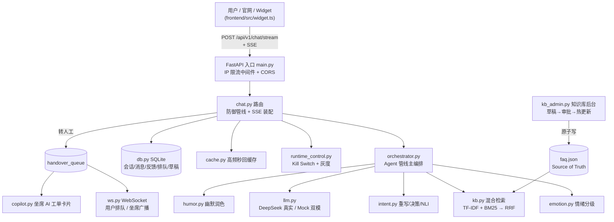
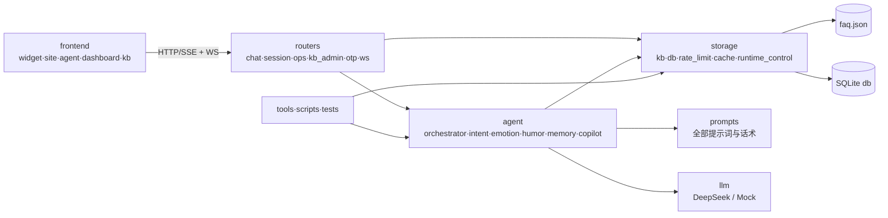
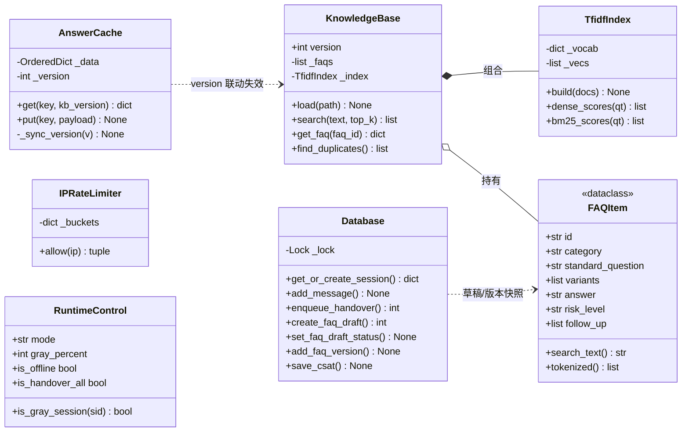
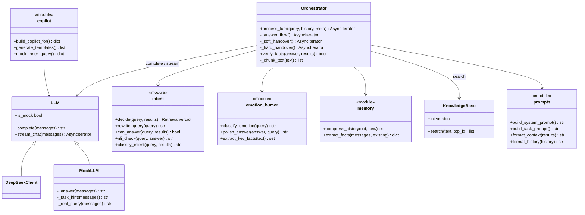
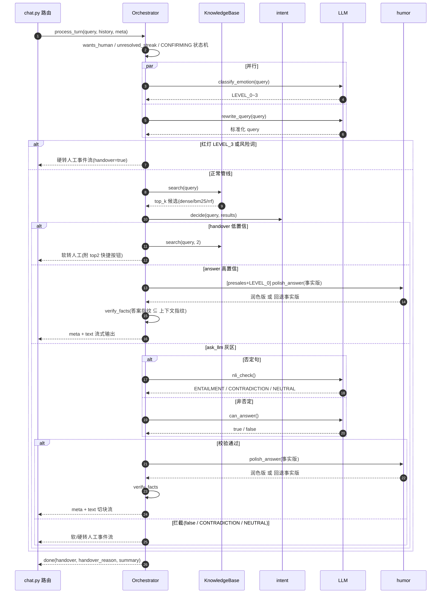
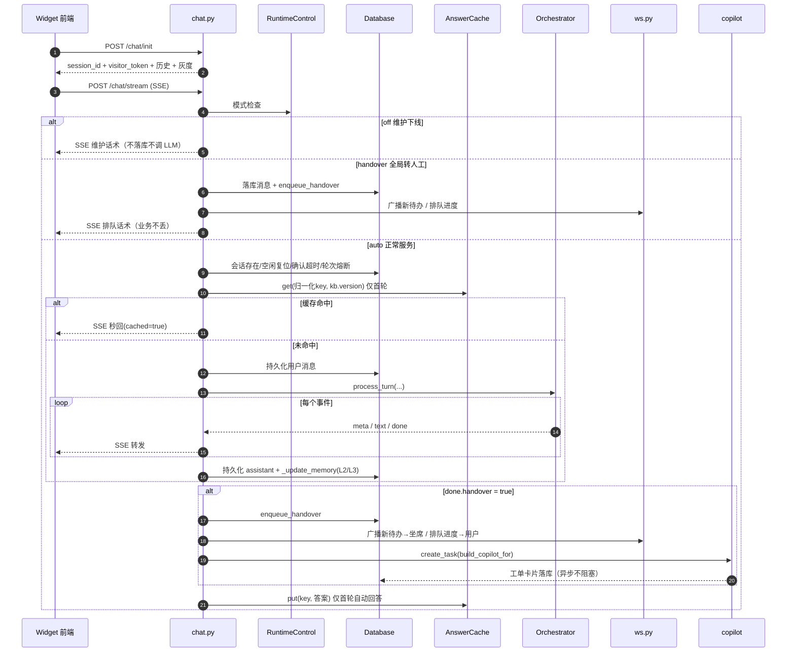
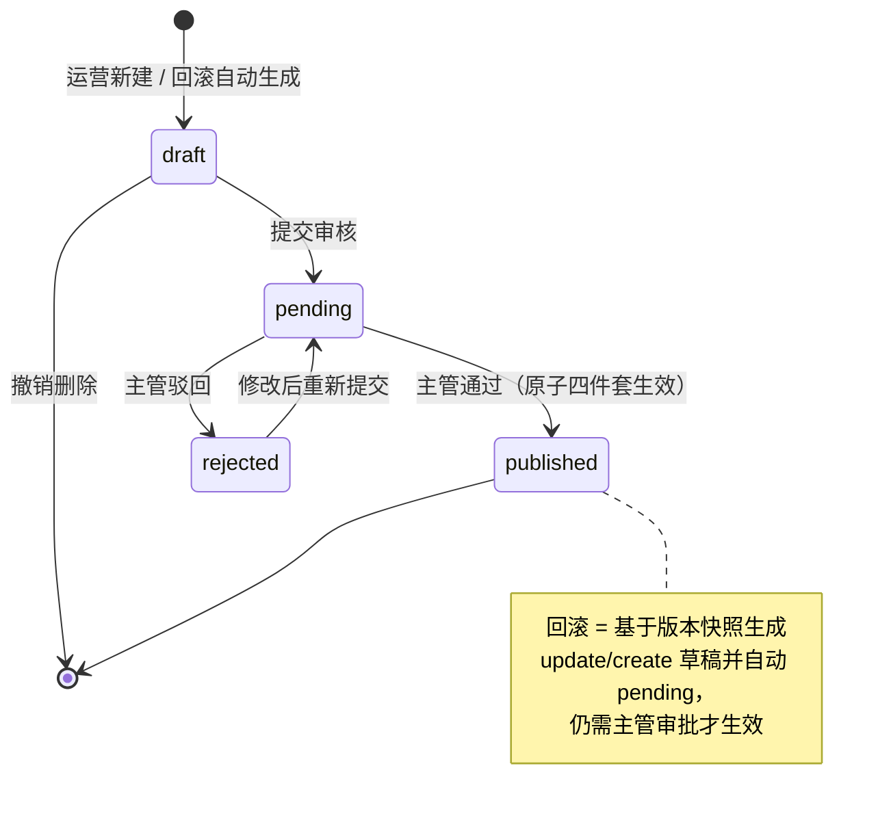
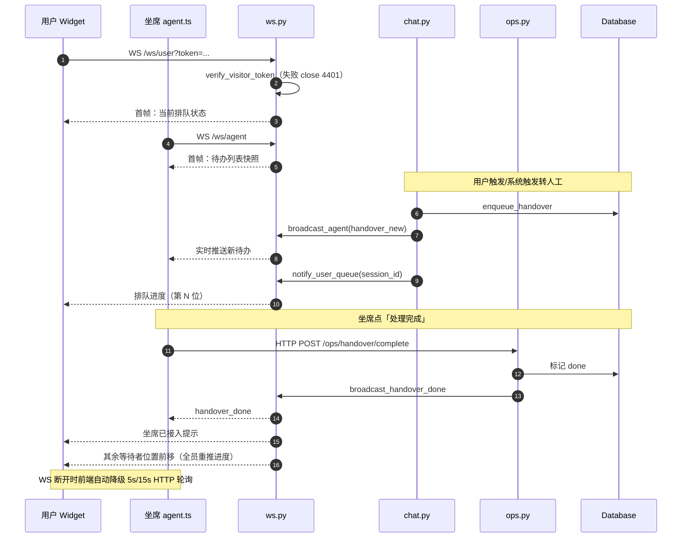
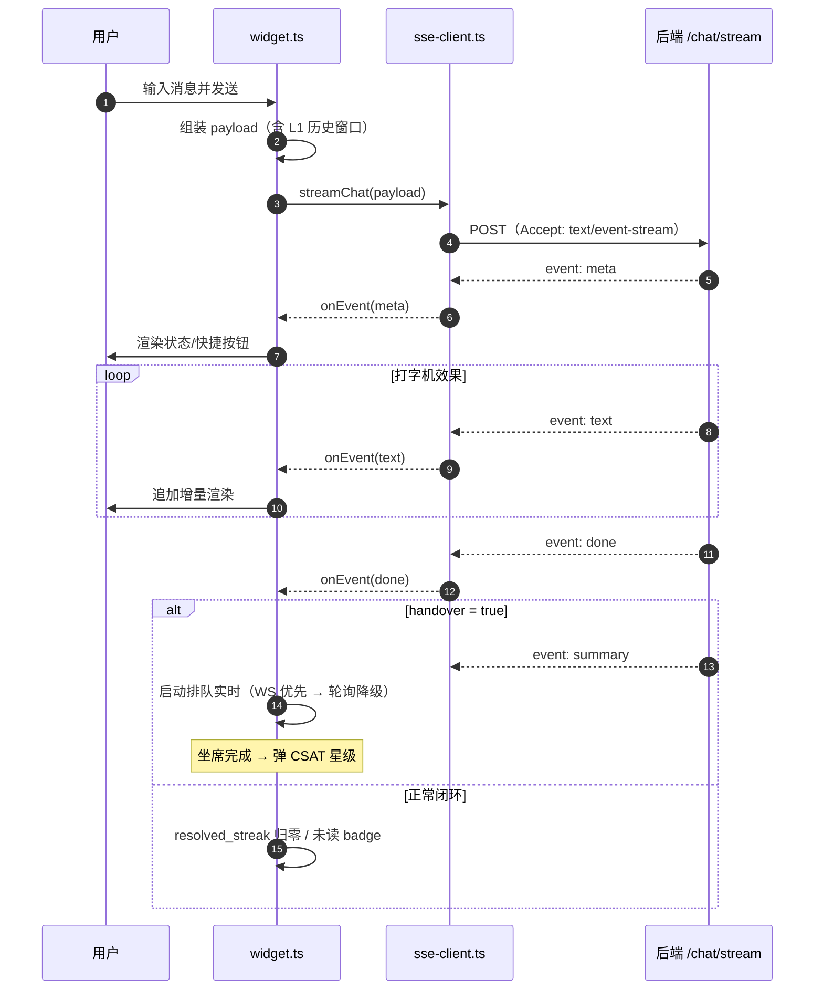

# 小答（smart_bot）源码解读

> 一句话定位：**RAG 驱动的网页端客服 Agent**——知识库命中自动答，未命中/高风险/情绪激动自动转人工，附带官网落地页、可嵌入 Widget、坐席工作台、运营看板与知识库后台，形成完整运营闭环。

本文档按「自顶向下 → 逐层拆解 → 设计点评 → 学习路径」的顺序组织，所有结论均直接来自源码，标注了对应文件与函数，可对照阅读。

---

## 1. 全局架构：一条请求的旅程



核心理念（README 与 plan.md 一以贯之）：**能自动的高效自动，该转人工的绝不硬扛**。整条管线围绕「什么情况下 AI 答最少 1 次 LLM 调用都不用，什么情况下必须转人」展开。

---

## 2. 目录结构导览

```
smart_bot/
├── backend/app/
│   ├── main.py            # FastAPI 入口：中间件 + 知识库加载 + 路由注册
│   ├── config.py          # 全部配置（.env 驱动，阈值/开关集中在这）
│   ├── models/schemas.py  # Pydantic 请求/响应模型（前后端契约唯一来源）
│   ├── routers/           # HTTP/WS 路由层（薄，防御+编排+落库）
│   │   ├── chat.py        #   核心：init / stream(SSE) / handover
│   │   ├── session.py     #   匿名↔登录绑定 + 点赞点踩
│   │   ├── ops.py         #   运营统计 / 坐席 / Kill Switch / CSAT / Copilot
│   │   ├── kb_admin.py    #   知识库后台：草稿审批流 + 版本 + 热更新
│   │   ├── otp.py         #   聊天内 OTP 验证码
│   │   └── ws.py          #   WebSocket 实时通道（用户排队 / 坐席广播）
│   ├── agent/             # AI 策略层（无框架，纯手写管线）
│   │   ├── orchestrator.py#   主编排：决策状态机 + SSE 事件流产出
│   │   ├── intent.py      #   查询重写 / 两级阈值决策 / can_answer / NLI
│   │   ├── emotion.py     #   情绪分级 LEVEL_0~3
│   │   ├── humor.py       #   幽默两段式 + 关键事实指纹校验
│   │   ├── memory.py      #   分层记忆 L2 摘要 / L3 结构化事实
│   │   ├── copilot.py     #   坐席侧：工单卡片 / 回复模板 / Mock 内部查询
│   │   ├── prompts.py     #   所有 Prompt 与话术模板
│   │   └── llm.py         #   DeepSeek 客户端 + MockLLM + 统一门面
│   └── storage/           # 存储与基础设施
│       ├── kb.py          #   知识库 + TF-IDF/BM25 索引 + RRF 融合检索
│       ├── db.py          #   SQLite 全部表与 CRUD
│       ├── rate_limit.py  #   IP 限流 + Visitor Token（HMAC）
│       ├── cache.py       #   高频问题秒回缓存（版本联动失效）
│       └── runtime_control.py # Kill Switch（auto/handover/off）+ 灰度
├── backend/tools/         # badcase_report.py（点踩归因）/ check_duplicates.py（重复检测）
├── backend/tests/         # conftest / test_api / eval（黄金集评测）/ load_test ...
├── frontend/src/          # Vite+TS：widget(Web Component) / sse-client / api / 四个页面入口
├── knowledge_base/
│   ├── faq.json           # 知识库唯一数据源（40 条 FAQ）
│   ├── build_kb.py        # 离线全量构建 + 健康检查 + 抽样自检
│   └── import_kb_to_admin.py # 存量 FAQ 补录后台审批流（幂等）
└── scripts/               # check.sh 一键质检 / healthcheck.py 巡检告警 / install-cron.sh
```

模块依赖关系图（自顶向下单向依赖，无循环）：



---

## 3. 启动链路：main.py 做了什么

`backend/app/main.py`（全文仅 63 行）：

1. **模块导入即建库**：`from app.storage.kb import kb` → `kb.load(settings.KB_PATH)`，进程启动时把 `faq.json` 全量构建进内存索引（40 条毫秒级）。
2. **CORS 全开**（`allow_origins=["*"]`，开发期友好，生产应收紧）。
3. **IP 限流中间件**：只拦 `/api/*`，超限直接 429（`rate_limit_middleware`，10 次/分）。
4. **`/health`**：返回品牌、LLM 模式（real/mock）、FAQ 条数——巡检脚本的探测点。
5. **路由注册放在文件末尾**：`from app.routers import chat, kb_admin, ops, otp, session, ws`，避免循环导入（路由模块都会反向 import storage/agent）。

两个全局单例贯穿全项目，值得先记住：

```python
kb  = KnowledgeBase()   # storage/kb.py 末尾 —— 知识库 + 检索索引
db  = Database()        # storage/db.py 末尾 —— SQLite 连接与锁
llm = LLM()             # agent/llm.py 末尾 —— 真实/Mock 自动切换门面
```

```python
# main.py —— 网关层 IP 限流中间件（只拦 /api/*，超限 429）
@app.middleware("http")
async def rate_limit_middleware(request: Request, call_next):
    if request.url.path.startswith("/api/"):
        ip = request.client.host if request.client else "unknown"
        ok, remaining = rate_limiter.allow(ip)
        if not ok:
            return JSONResponse(
                status_code=429,
                content={"detail": "请求太频繁啦，请稍后再试", "remaining": remaining},
            )
    return await call_next(request)
```

`config.py` 是唯一的配置出口，几个关键值建议背下来（调参都在这）：

| 配置 | 默认 | 作用 |
|---|---|---|
| `SIM_THRESHOLD_LOW / HIGH` | 0.22 / 0.40 | 两级置信度阈值，决定 直接答 / 问 LLM / 转人工 |
| `SESSION_MAX_TURNS` | 30 | 单会话轮次硬上限（成本熔断） |
| `SESSION_TIMEOUT_MINUTES` | 30 | 会话空闲自动复位 |
| `CONFIRM_TIMEOUT_SECONDS` | 30 | 确认状态超时取消 |
| `REPEAT_UNRESOLVED_LIMIT` | 2 | 连续未解决 N 轮 → 强制转人工（防死循环） |
| `use_real_llm` | auto | 有 `DEEPSEEK_API_KEY` 走真实，否则 Mock——**全链路可离线跑** |

---

## 4. 存储层（storage/）

存储层类图总览：



### 4.1 kb.py —— 检索的心脏（316 行，无外部依赖）

**数据模型**：`FAQItem` dataclass（id/category/standard_question/variants/answer/risk_level/follow_up）。`search_text` 把「标准问法+变体+答案」拼成检索文本；`tokenized()` 是关键设计——**问法特征权重 1.0、答案权重 0.2**，防止长答案稀释问法匹配（`FAQItem.tokenized`）。

**分词**（`tokenize_full`）：jieba 词 + 中文连续字符 bigram（权重 0.7）混合特征。这是为了口语鲁棒性：

```
「拆了包装还能退吗」 → bigram: 拆了/了包/包装/装还/还能/能退/退吗
「拆封了还能退吗」   → bigram: 拆封/封了/了还/还能/能退/退吗   ← 共享 还能/能退/退吗
```

```python
# kb.py —— 混合特征：jieba 词(权重1.0) + 中文连续字符 bigram(权重0.7)
def tokenize_full(text: str, bigram_weight: float = 0.7) -> list[tuple[str, float]]:
    feats: list[tuple[str, float]] = [(w, 1.0) for w in tokenize(text)]
    chars = "".join(_CHINESE_RE.findall(text))
    for i in range(len(chars) - 1):
        feats.append(("bg_" + chars[i:i + 2], bigram_weight))
    return feats
```

**索引**：`TfidfIndex` 一个类同时实现两路检索——
- `dense_scores()`：手工 TF-IDF（`(1+ln tf)·idf` + L2 归一化）余弦相似度，产出 0~1 分数供阈值决策；
- `bm25_scores()`：标准 BM25（k1=1.5, b=0.75）。

**融合检索**（`KnowledgeBase.search`）：两路各自排序后用 **RRF（Reciprocal Rank Fusion，k=60）** 融合：

```python
# kb.py —— search 核心：双路召回 + RRF 融合重排（节选）
dense = self._index.dense_scores(qt)          # 路 1：TF-IDF 余弦（0~1，供阈值决策）
bm25 = self._index.bm25_scores(qt)            # 路 2：BM25 关键词
k = 60
dense_rank = sorted(range(n), key=lambda i: (-dense[i], i))
bm25_rank = sorted(range(n), key=lambda i: (-bm25[i], i))
fused: dict[int, float] = defaultdict(float)
for rank, i in enumerate(dense_rank):
    fused[i] += 1.0 / (k + rank + 1)          # 按名次贡献，与分数绝对值无关
for rank, i in enumerate(bm25_rank):
    fused[i] += 1.0 / (k + rank + 1)
top_idx = sorted(fused, key=lambda i: (-fused[i], -dense[i]))[:top_k]
```

返回 top_k 候选，每个携带 `dense_score`（供阈值判断）、`bm25_score`、`combined`。**生产替换为真 Embedding+Qdrant 时，只需保持这个 search() 签名不变**——这是接口设计的留白。

同文件还有一组**纯规则判定函数**，被全线复用：`has_negation`（否定/反问正则）、`has_risk_keyword`（投诉/法律/金额红线词表）、`wants_human`（转人工关键词）、`is_confirmation / is_denial`（确认状态机的 yes/no 词表）。

### 4.2 db.py —— SQLite 六张表

`sessions / messages / feedback / handover_queue / faq_drafts / faq_versions / csat`。要点：

- **线程安全**：`threading.Lock` + 每次操作独立连接 + `PRAGMA journal_mode=WAL`（`_connect`）。
- **sessions.meta 是 JSON 字符串**，承载了状态机的扩展字段：`summary`（L2 摘要）、`facts`（L3 事实）、`pending_faq_id`（确认状态）、`unresolved_streak`（防死循环计数）、`otp_pending / otp_verified`。一张 meta 字段顶了半个状态存储。
- **草稿状态机**（`set_faq_draft_status`）：`allowed` 字典白名单合法迁移 `draft→pending→published/rejected`、`rejected→pending`，防并发跳转。

```python
# db.py —— 状态机白名单：不在表内的迁移一律拒绝（防并发跳转/乱序）
allowed = {
    ("draft", "pending"): True,
    ("pending", "published"): True,
    ("pending", "rejected"): True,
    ("rejected", "pending"): True,   # 驳回后可修改再提交
}
```

- **轻量迁移**：`init_db` 里用 `PRAGMA table_info` 检查列是否存在，缺则 `ALTER TABLE ADD COLUMN`（copilot/status/note），旧库平滑升级。

### 4.3 rate_limit.py —— 安全两层

- `IPRateLimiter`：deque 滑动窗口，60 秒内 ≥limit 即拒。
- **Visitor Token**：`base64({s: session_id, e: exp}).HMAC-SHA256 签名`。校验三件事：签名、与会话绑定、未过期（`verify_visitor_token`，`hmac.compare_digest` 防时序攻击）。裸 curl 不带 token 一律 401。

```python
# rate_limit.py —— Visitor Token：base64(payload) + HMAC-SHA256 签名（节选）
def generate_visitor_token(session_id: str, ttl_hours: int | None = None) -> str:
    exp = int(time.time()) + ttl * 3600
    payload = base64.urlsafe_b64encode(
        json.dumps({"s": session_id, "e": exp}, separators=(",", ":")).encode()
    ).decode()
    return f"{payload}.{_sign(payload)}"

def verify_visitor_token(token: str, session_id: str) -> bool:
    try:
        payload, sig = token.rsplit(".", 1)
        if not hmac.compare_digest(_sign(payload), sig):
            return False                          # ① 签名合法
        data = json.loads(base64.urlsafe_b64decode(payload.encode()))
        if data.get("s") != session_id:
            return False                          # ② 与会话绑定
        if int(data.get("e", 0)) < time.time():
            return False                          # ③ 未过期
        return True
    except Exception:
        return False
```

### 4.4 cache.py —— 高频秒回缓存

仅缓存**会话首轮 + 自动回答**的结果。三个精妙点：

1. **key 归一化**（`normalize_query`）：分词+去停用词后 join，「拆了包装还能退吗」与「拆了包装还能退吗？」同 key。
2. **版本联动失效**（`_sync_version`）：`kb.version` 每次索引重建 +1，缓存发现版本变了整体清空——防止审批改了口径还被旧答案秒回。
3. **淘汰策略**：容量满时淘汰「命中次数最少且最久未命中」。

```python
# cache.py —— 版本联动失效：kb.version 每次索引重建 +1，版本变了整体清空
def _sync_version(self, kb_version: int) -> None:
    if kb_version != self._version:
        self._data.clear()
        self._version = kb_version
```

### 4.5 runtime_control.py —— Kill Switch + 灰度

- 服务模式三档：`auto`（正常）/ `handover`（全局转人工：不走检索不调 LLM，所有对话直接登记人工——**半切保业务不丢**）/ `off`（维护下线全切）。
- 灰度：`sha256(session_id)` 前 8 位 hex mod 100 < gray_percent，**同一会话稳定同组不抖动**。当前灰度只在 init 响应标注 `gray=true`，为未来 A/B 留的观测位。

```python
# runtime_control.py —— 按会话稳定哈希灰度（同会话全程同组，不抖动）
def is_gray_session(self, session_id: str) -> bool:
    if self._gray_percent <= 0:
        return False
    if self._gray_percent >= 100:
        return True
    digest = hashlib.sha256(session_id.encode("utf-8")).hexdigest()
    bucket = int(digest[:8], 16) % 100
    return bucket < self._gray_percent
```

---

## 5. Agent 层（agent/）—— 本项目的精华

Agent 层类图（纯函数模块用 `<<module>>` 标注，均无类状态）：



### 5.1 orchestrator.py —— 主编排状态机（404 行，先读这个）

`process_turn()` 是全部对话逻辑的总入口，决策顺序本身就是设计文档：

```
1.  wants_human(query)?            ──► 硬转人工（用户主动，不挽留）
1.5 unresolved_streak ≥ 2?         ──► 硬转人工（防死循环，chat 层维护计数）
2.  CONFIRMING 状态机              ──► 「是/对」→ 直接答确认的 FAQ
                                       「不是」→ 礼貌关闭，clear_pending
                                       其他输入 → 打断确认，进入新意图
3+5. 情绪分级 ∥ 查询重写           ──► asyncio.create_task 并行（省首字延迟）
4.  LEVEL_3 或风险词?              ──► 取消重写任务，硬转人工（红灯熔断）
5'. kb.search(重写后 query)        ──► 混合检索 → decide() 两级阈值
6.  decision == handover           ──► 软转人工（澄清式挽留：给出 top2 候选让用户选）
    decision == ask_llm:
       否定句?  → NLI 校验：CONTRADICTION 硬转 / NEUTRAL 软转 / ENTAILMENT 继续答
       非否定?  → can_answer 布尔判断，false 软转
7.  top_faq.risk_level == high     ──► 硬转人工（红线 FAQ 不直接答）
8.  _answer_flow()                 ──► 生成 + 幽默 + 输出校验
```

真实代码对照（`process_turn` 前置拦截与并行，节选）：

```python
# orchestrator.py —— 注释即决策依据
if wants_human(query):                       # 1. 用户主动转人工：立即转，不挽留
    async for ev in self._hard_handover(query, history, reason="user_request", ...):
        yield ev
    return

if int(meta.get("unresolved_streak", 0) or 0) >= settings.REPEAT_UNRESOLVED_LIMIT:
    ...                                      # 1.5 连续 N 轮未解决 → 防死循环硬转

# 3+5. 情绪分级 与 查询重写并行（互不依赖，降低首字延迟）
emotion_task = asyncio.create_task(classify_emotion(query))
rewrite_task = asyncio.create_task(rewrite_query(query)) if rewrite_needed else None

# 4. 红灯熔断：极差情绪 / 风险词 → 取消重写任务（省成本），直接硬转
emotion = await emotion_task
if emotion == "LEVEL_3" or has_risk_keyword(query):
    if rewrite_task:
        rewrite_task.cancel()
    async for ev in self._hard_handover(query, history, reason="emotion_red", ...):
        yield ev
    return
```

**软转 vs 硬转**是核心业务区分：
- `_soft_handover`：低置信但「差一点」，回复里给出 top1/top2 标准问法做快捷按钮让用户点选确认（`HANDOVER_SOFT_MSG`），同时 `done` 事件仍带 `handover=true` 计入未解决。
- `_hard_handover`：按 reason 选话术（红灯道歉 / 高风险 FAQ 答案 / 用户主动 / 连续未解决），直接登记人工。

**`_answer_flow` 的幽默两段式**（V2.0）：
- 幽默开关 = 分类是 `presales` **且** 情绪 LEVEL_0（`_HUMOR_ALLOWED_CATEGORIES`）。
- 开启时：先用正经 Prompt 流式攒完整事实版 → `polish_answer` 润色 → 校验通过后按 12 字切块重放；关闭时逐 token 直通流式（首字延迟优先）。

```python
# orchestrator.py —— 幽默两段式 vs 直通流式（_answer_flow 节选）
if humor_on:
    async for token in llm.stream_chat(messages, temperature=0.2):
        full += token                        # 先攒完整事实版，不外发
    polished = await polish_answer(full, query)
    if polished:
        full = polished                      # 润色校验不过会自动回退事实版
    for chunk in _chunk_text(full):
        yield {"type": "text", "data": {"content": chunk}}
else:
    async for token in llm.stream_chat(messages, temperature=0.2):
        full += token
        yield {"type": "text", "data": {"content": token}}   # 逐 token 直通，首字延迟最优
```

**输出校验**（`verify_facts`）：回答中抽出的「数字+单位」指纹必须是检索上下文指纹的子集，否则判疑似幻觉 → 整条替换为兜底话术并 `handover_reason="hallucination_fallback"` 转人工。这是防幻觉第三层。

```python
# orchestrator.py —— 输出校验（防幻觉第三层，生成后）
def verify_facts(answer: str, results: list[dict]) -> bool:
    """回答中出现的数字/金额/时间必须能在检索上下文里找到依据，否则视为疑似幻觉。"""
    facts_in_answer = extract_key_facts(answer)
    if not facts_in_answer:
        return True
    facts_in_context = extract_key_facts(format_context(results))
    return facts_in_answer.issubset(facts_in_context)
```

决策全流程时序图（把上面的决策序完整串一遍）：



**产物是统一的 SSE 事件 dict 流**：`meta`（状态/情绪/意图/置信度/快捷按钮/重写后 query）→ `text`（增量）→ `done`（handover 标记/摘要）。`_chunk_text` 把固定话术切块模拟打字机，前端动效无需感知来源。

### 5.2 intent.py —— 决策与语义校验

- `decide()`（零 LLM 路径）：`<0.22 → handover`，`0.22~0.40 → ask_llm`，`>0.40 → answer`；否定词强制 `ask_llm`。
- `can_answer()`：LLM 只回 true/false（max_tokens=8），失败时**按可回答处理**（宁可多答，失败有输出校验兜底）。
- `nli_check()`：三分类 ENTAILMENT/CONTRADICTION/NEUTRAL，专治「不支持退货对吧？」这种词面重合但语义相反的否定句。
- `rewrite_query()`：口语化→标准问法，**只影响检索，不影响安全判断**；Mock/失败回退原 query。

```python
# intent.py —— 两级阈值决策（零 LLM 快路径）
def decide(query: str, results: list[dict]) -> RetrievalVerdict:
    if not results:
        return RetrievalVerdict("handover", results, 0.0, "no_candidate")
    score = results[0]["dense_score"]
    if has_negation(query):          # 否定句：词面重合但语义可能相反 → 强制 NLI
        return RetrievalVerdict("ask_llm", results, score, "negation_nli")
    if score < settings.SIM_THRESHOLD_LOW:            # 0.22
        return RetrievalVerdict("handover", results, score, "low_confidence")
    if score <= settings.SIM_THRESHOLD_HIGH:          # 0.40
        return RetrievalVerdict("ask_llm", results, score, "mid_confidence")
    return RetrievalVerdict("answer", results, score, "high_confidence")
```

### 5.3 emotion.py / humor.py / memory.py

- `classify_emotion`：LLM 分级为主，关键词表兜底（12315/曝光/起诉 → LEVEL_3）。红灯即转人工，这是「情绪熔断」。
- `humor.py`：`extract_key_facts` 用正则抽「数字+可选单位」指纹（做了全半角/空白归一）；`polish_answer` 润色后**指纹必须超集**且长度不得暴增（防编造），否则回退事实版。
- `memory.py` 分层记忆：
  - L1：滑动窗口最近 5 轮（已有，不重复处理）；
  - L2 `compress_history`：窗口外早期对话 → ≤100 字摘要，**增量合并**（已有摘要+新增一起再压缩）；
  - L3 `extract_facts`：JSON 提取 {user_intent, order_info, product, request}，覆盖式合并，失败沿用旧值。
  - 触发时机：由 chat 路由每轮在 `finally` 里维护，存进 `session.meta`。

`humor.py` 的润色校验（关键信息绝不被篡改的两道闸门）：

```python
# humor.py —— 润色后关键指纹必须超集 + 长度不得暴增，否则回退事实版
facts_before = extract_key_facts(fact_answer)        # 润色前的数字/时间/金额指纹
polished = await llm.complete(..., temperature=0.8, max_tokens=120)
...
facts_after = extract_key_facts(polished)
if not facts_before.issubset(facts_after):
    return fact_answer                # 闸门 1：润色改动了关键数字/时间/金额
if len(polished) > len(fact_answer) * 2 + 30:
    return fact_answer                # 闸门 2：长度暴增 = 疑似编造细节
return polished
```

### 5.4 llm.py —— 一套代码两种模式

`LLM` 门面持有 `DeepSeekClient | None` + `MockLLM`。**MockLLM 是离线开发/测试的关键**：通过识别 Prompt 里的任务特征串（如「情绪等级」「只输出 true 或 false」「ENTAILMENT」）分支返回规则化输出（`MockLLM._answer`），连流式都是 6 字切块模拟。这让 pytest、压测、CI 全部零成本离线跑。

```python
# llm.py —— MockLLM：识别 Prompt 里的任务特征串，分支返回规则化输出（节选）
def _answer(self, messages: list[dict]) -> str:
    hint = self._task_hint(messages)     # 拼接 system+user 内容做特征匹配
    user = self._real_query(messages)    # 从「用户消息：」标记后提取真实输入
    if "情绪等级" in hint:                # 情绪分级任务
        if any(k in user for k in ("投诉", "举报", "曝光", "12315", "315", "报警", "诈骗", "起诉")):
            return "LEVEL_3"
        if any(k in user for k in ("破", "坏", "再也不买", "气死", "太慢")):
            return "LEVEL_2"
        return "LEVEL_0"
    if "只输出 true 或 false" in hint:    # can_answer 布尔判断任务
        if any(k in user for k in ("老板是谁", "天气", "写首诗", "1加1")):
            return "false"               # 明显超纲 → false
        return "true"
    if "ENTAILMENT" in hint and "CONTRADICTION" in hint:
        return "ENTAILMENT"              # NLI Mock 恒返回蕴含
    return f"（Mock）知识库检索结果：{user[:40]}"   # 兜底：模拟事实版回答
```

### 5.5 prompts.py —— 所有提示词与话术的集中地

`build_system_prompt()` 生成的 System Prompt 值得逐句读：身份披露铁律（绝不伪装真人）、事实 100% 来自知识库、禁模糊词、转人工规则、按情绪等级切换幽默规则，尾部占位 `{summary} {facts} {context} {history} {query}`。另有 9 个任务 Prompt（EMOTION/QUERY_REWRITE/CAN_ANSWER/NLI/POLISH/MEMORY×2/COPILOT/SUMMARY）和 10 条固定话术常量（软/硬转、红灯、维护、超限……），运营改话术只动这一个文件。

### 5.6 copilot.py —— 坐席 AI（服务 Bot 的另一半）

- `extract_ticket`：转人工后把会话压成 JSON 工单卡 {user_intent, order_info, bot_answered, issue}，失败回退正则抽订单号 `[A-Za-z]{1,6}\d{8,}`。
- `generate_templates`：按工单+知识库 top2 生成 3 个快捷回复（「|」分隔）。
- `build_copilot_for`：转人工后由 chat 路由 `asyncio.create_task` **异步**调用，不阻塞 SSE。
- `mock_inner_query`：物流/订单/退款内部查询，明确标注【开发期演示】。

---

## 6. 路由层（routers/）

### 6.1 chat.py —— 对话主路由（327 行，第二该读）

`POST /chat/stream` 的**防御管线**按序执行，任何一步命中即短路返回 SSE：

```
①Visitor Token 校验(401) → ②维护模式(off)：直接维护话术，不落库不入队
→ ③会话存在(404) → ④30 分钟空闲复位(reset_session) → ⑤确认 30 秒超时清除
→ ⑥全局转人工(handover)：落库+入队+广播，SSE 直接给排队话术
→ ⑦超长输入拦截 → ⑧30 轮上限 → ⑨首轮缓存命中：秒回(cached=true)
→ ⑩正常管线：落库用户消息 → orchestrator → 逐事件转发
```

真实代码对照（`chat_stream` 防御管线节选，`...` 为省略的 SSE 装配细节）：

```python
# chat.py —— 按序短路，任一步命中即直接返回 SSE
if not verify_visitor_token(req.visitor_token, req.session_id):
    raise HTTPException(status_code=401, detail="invalid visitor token")   # ①

if runtime.is_offline:                    # ② 维护全切：不落库不调 LLM 不入队
    return StreamingResponse(_sse("meta", {"status": "maintenance", ...}) + ...)

_idle = (datetime.now() - datetime.strptime(session["updated_at"], ...)).total_seconds()
if _idle > settings.SESSION_TIMEOUT_MINUTES * 60:      # ④ 30 分钟空闲复位
    db.reset_session(req.session_id)

if runtime.is_handover_all:               # ⑥ 全局转人工半切：直接登记人工
    qid = db.enqueue_handover(req.session_id, summary)
    ...

if len(req.message) > settings.MAX_INPUT_LEN:          # ⑦ 超长拦截
    ...
if turn_count >= settings.SESSION_MAX_TURNS:           # ⑧ 轮次熔断
    ...
cached = answer_cache.get(cache_key, kb.version)       # ⑨ 首轮缓存秒回（cached=true）
```

`/chat/stream` 完整时序图（三档服务模式下的分支全景）：



`event_stream()` 内部的两个收尾逻辑是理解状态机的关键：

- **done 事件处理**：`handover=true` → `meta.unresolved_streak += 1`（封顶），正常闭环归零——这就是防死循环计数的维护点；`clear_pending` → 清确认状态。
- **finally 块**：无论客户端是否断开，都持久化 assistant 消息并跑 `_update_memory`（L2/L3），保证记忆不丢。

```python
# chat.py —— done 事件处理（节选）：防死循环计数 + 确认状态清除都在这里
elif ev["type"] == "done":
    handover = bool(ev["data"].get("handover"))
    _m2 = dict(session.get("meta", {}))
    _streak = int(_m2.get("unresolved_streak", 0) or 0)
    # 转人工 → +1（封顶不累加），正常闭环 → 归零
    _m2["unresolved_streak"] = min(_streak + 1, settings.REPEAT_UNRESOLVED_LIMIT + 1) if handover else 0
    if ev["data"].get("clear_pending"):
        _m2.pop("pending_faq_id", None)
        db.update_session(req.session_id, meta=_m2, status="AGENT_ACTIVE")
```

转人工后 `_notify_and_build_copilot()`：先同步 WS 广播（新待办→坐席、排队进度→用户），再 `create_task` 异步生成工单卡片。

`POST /chat/init`：创建/恢复会话 + 下发 Visitor Token + 拉历史（解决刷新「视觉失忆」）+ 灰度标记。

### 6.2 kb_admin.py —— 知识库审批流（运营闭环的核心）

状态机：`draft → pending → published / rejected（可改后重提）`。

**生效动作 `_apply_draft`** 是四件套原子操作（持 `_apply_lock` 串行）：

```
读 faq.json → 按 action 修改 faqs（create 查重 / update 校验存在 / delete 留删除前快照）
→ 原子写（tempfile + os.replace，杜绝半写）
→ kb.load() 热重建索引（version+1 → 高频缓存自动失效）
→ 记 faq_versions 快照 → 草稿置 published
```

真实代码对照（`kb_admin.py` 节选）：

```python
# kb_admin.py —— 原子写：临时文件 + os.replace，杜绝半写状态
def _write_faq_file_atomic(data: dict) -> None:
    fd, tmp = tempfile.mkstemp(dir=str(path.parent), prefix=".faq_", suffix=".json.tmp")
    try:
        with os.fdopen(fd, "w", encoding="utf-8") as f:
            json.dump(data, f, ensure_ascii=False, indent=2)
        os.replace(tmp, path)               # 原子替换
    finally:
        if os.path.exists(tmp):
            os.unlink(tmp)

# kb_admin.py —— 审批生效四件套（调用方持 _apply_lock 串行，节选）
async def _apply_draft(draft: dict, operator: str) -> dict:
    data = _read_faq_file()
    if action == "create":
        if faq_id in index:
            raise HTTPException(status_code=409, detail=f"FAQ {faq_id} 已存在，无法重复新建")
        snapshot = dict(payload)
        faqs.append(snapshot)
    elif action == "delete":
        snapshot = dict(faqs[index[faq_id]])   # 删除前快照，供回滚恢复
        faqs.pop(index[faq_id])
    _write_faq_file_atomic(data)               # ① 原子写 faq.json
    kb.load(str(settings.KB_PATH))             # ② 热重建索引（version+1 → 缓存自动失效）
    db.add_faq_version(faq_id, action, snapshot, operator)        # ③ 记版本快照
    db.set_faq_draft_status(draft["id"], "published", operator)   # ④ 草稿置生效
```

**一键回滚** `POST /versions/{id}/rollback`：基于版本快照生成 update（FAQ 还在）或 create（FAQ 已删，按原 id 恢复）草稿并**自动提交审核**——回滚同样要走审批，这是刻意的铁律设计。防并发细节：approve 接口在锁内**重读草稿状态**，避免双击重复审批。

草稿生命周期状态图（回滚也走审批链）：



### 6.3 ops.py / ws.py / otp.py / session.py

- `ops.py`：统计口径「**转过人工即归人工**」（auto_rate + handover_rate = 100%）；运行控制 PUT；Bad Case 状态流转；CSAT 提交与统计；坐席 Copilot 三接口（卡片/模板/内部查询，模板与卡片都落库复用）。
- `ws.py`：`ConnectionManager` 维护 `users: dict[session_id, set[WS]]` 与 `agents: set[WS]`。`/ws/user` 校验 Visitor Token（失败 close 4401），建连即推一次当前排队状态；`/ws/agent` 可选 `AGENT_WS_TOKEN`，首帧下发待办快照。**一个妙点**：`broadcast_handover_done` 除了通知双方，还给**所有在等用户**重推排队进度（前面有人完成→位置前移）。前端 WS 失败自动回退 5s/15s HTTP 轮询（完整前后端数据流拆解见 §6.4）。
- `otp.py`：验证码存 `session.meta.otp_pending`（TTL 10 分钟），`OTP_MOCK_MODE=true` 时响应直接带 code 供联调；verify 通过后写 `otp_verified` 临时安全状态，`secrets.compare_digest` 防时序攻击。
- `session.py`：`/session/bind`（匿名→登录，历史零丢失）与 `/feedback`（点踩落库即 Bad Case 原料）。

```python
# ws.py —— 坐席完成后：通知双方 + 所有在等用户位置前移（节选）
async def broadcast_handover_done(self, queue_id: int, session_id: str) -> None:
    await self.broadcast_agent({"type": "handover_done", "queue_id": queue_id})
    await self.notify_user_agent_joined(session_id, queue_id)
    for sid in list(self._users):          # 前面有人完成 → 其余等待者进度前移
        await self.notify_user_queue(sid)
```

转人工全链路实时时序图（WS + 降级轮询）：



### 6.4 WebSocket 实时通道：前后端完整数据流

> 本节把上面 `ws.py` 的三行概述展开成完整协议与链路。一句话结论：**WebSocket 只做事件通知，不传输聊天内容**；聊天内容仍由 `/chat/stream` 的 SSE 负责，排队与待办状态以 HTTP + SQLite 为唯一事实源。

#### 6.4.1 总体结构

`ws.py` 第 32–107 行的 `ConnectionManager` 维护**进程内内存连接表**：

- `_users: dict[str, set[WebSocket]]`：按 `session_id` 分组，同一会话允许多个标签页同时在线；
- `_agents: set[WebSocket]`：所有坐席连接，广播时全量下发、不区分坐席；
- `_lock: asyncio.Lock`：只保护连接集合的增删与快照复制，推送期间不持锁（避免慢连接阻塞其他推送）。

两个端点都注册在 `main.py` 末尾（第 63 行）：`/ws/user` 与 `/ws/agent`。

#### 6.4.2 建连与鉴权

| 端点 | 鉴权 | 失败行为 | 建连首帧 |
|---|---|---|---|
| `/ws/user?session_id=&visitor_token=` | `verify_visitor_token`：HMAC 签名 + 会话绑定 + 未过期 | `close(4401)`，不 accept | 立即 `notify_user_queue()` 推一次当前排队状态 |
| `/ws/agent?token=` | `settings.AGENT_WS_TOKEN` 非空时必须匹配 | `close(4401)` | 下发 `{"type":"handovers","data":[...]}` 待办快照 |

`visitor_token` 由 `/chat/init` 下发（`chat.py` 第 68 行 `generate_visitor_token`），WS 自身不签发；`AGENT_WS_TOKEN` 默认空字符串 = 开发期放行，生产必须配置。

建连后两端都进入 `while True: await websocket.receive_text()`：**只消费心跳/关闭帧，业务数据全部由服务端主动推送**。`/api/*` 的 IP 限流中间件不覆盖 WS 路径（`main.py` 第 34 行只判断 `/api/`）。

#### 6.4.3 消息协议（JSON 文本帧）

| 方向 | `type` | 载荷 | 触发时机 |
|---|---|---|---|
| 服务端 → 用户 | `queue` | `queue_id, position, ahead, status` | 入队、建连、前面有人完成 |
| 服务端 → 用户 | `agent_joined` | `queue_id` | 坐席完成该待办 |
| 服务端 → 坐席 | `handovers` | `data: [...]` | 坐席建连首帧快照 |
| 服务端 → 坐席 | `handover_new` | `queue_id` | 新增转人工排队 |
| 服务端 → 坐席 | `handover_done` | `queue_id` | 坐席标记完成 |

排队位置不是计数器，而是每次由 `db.queue_status()` 按 `id ASC` 现场统计 waiting 队列（`db.py` 第 340–357 行），因此天然抗乱序、无需额外维护位置字段。

#### 6.4.4 两条关键触发链路

**A. 用户转人工（写侧）**

1. 前端 `POST /api/v1/chat/stream`，后端判定转人工后执行 `update_session(HANDOVER)` + `enqueue_handover()`（`chat.py` 第 261–267 行）；
2. `_notify_and_build_copilot()` 先广播、再异步建 Copilot，避免阻塞 SSE（`chat.py` 第 309–327 行）：
   - `manager.broadcast_new_handover(qid)` → 所有坐席收到 `handover_new`；
   - `manager.notify_user_queue(session_id)` → 该用户收到 `queue`；
   - `asyncio.create_task(build_copilot_for(...))` 后台生成工单卡片；
3. SSE 流末尾追加一条 `summary`（带 `queue_id`），前端据此启动 WS（`chat.py` 第 273–279 行）。

手动转人工 `/chat/handover`（`chat.py` 第 288–306 行）走同一套 `_notify_and_build_copilot`，所以两条入口的实时行为完全一致。

**B. 坐席处理完成（读侧）**

1. 坐席 `POST /ops/handovers/{id}/complete` → `complete_handover`（仅 `waiting → done`，靠 `WHERE status='waiting'` 保证幂等）（`ops.py` 第 96–105 行、`db.py` 第 328–338 行）；
2. `broadcast_handover_done()` 做三件事（`ws.py` 第 99–104 行）：
   - 给所有坐席推 `handover_done`（前端触发列表刷新）；
   - 给该用户推 `agent_joined`；
   - **遍历所有在线 session 逐个重算并推 `queue`**，实现「后面的人位置前移」。

```python
# ws.py —— 排队状态推送：建连、入队、有人完成时都复用这一个入口
async def notify_user_queue(self, session_id: str) -> None:
    row = db.get_waiting_by_session(session_id)
    if not row:
        return                                  # 没有 waiting 记录 → 不推
    st = db.queue_status(row["id"])
    if st:
        await self.push_user(session_id, {
            "type": "queue", "queue_id": st["queue_id"],
            "position": st["position"], "ahead": st["ahead"], "status": st["status"],
        })
```

#### 6.4.5 前端实现

**用户 Widget**（`widget.ts` 第 616–716 行）

- `summary` 事件拿到 `queue_id` 后调 `startQueueLive()`；地址由 `api-base` 或当前 host 生成 `ws(s)://`；
- `onmessage` 按 `type` 直接改文案：`queue` 更新「前面还有 N 人」，`agent_joined` 或 `status=done` 则显示已接入并主动断开 WS；
- `onerror` / `onclose` → `fallbackPolling()`，降级为每 5s（失败 8s）轮询 `/api/v1/ops/queue/status`。

**坐席工作台**（`agent.ts` 第 18–72 行）

- 连 `/ws/agent`，把 WS 当作**失效信号**：收到 `handover_new` / `handover_done` 就调 HTTP `load()` 重拉两个列表，不解析载荷；
- `onerror → close() → onclose → degrade()`，之后**不再重连**，只靠 `setInterval(load, 15000)` 保底（`agent.ts` 第 298–303 行）。

```typescript
// agent.ts —— WS 仅作失效信号：收到事件后统一走 HTTP 重拉，避免两套数据源不一致
sock.onmessage = (msg) => {
  let data: { type?: string };
  try {
    data = JSON.parse(String(msg.data));
  } catch {
    return;
  }
  if (data.type === "handover_new" || data.type === "handover_done") void load();
};
```

开发期由 `vite.config.ts` 的 `/ws` 代理到 `127.0.0.1:8000` 并开启 `ws: true`；生产由网关或同源部署接管。

#### 6.4.6 降级策略与已知边界

| 端 | 断开/失败处理 | 轮询兜底 |
|---|---|---|
| 用户 Widget | `onerror`/`onclose` → 立即停 WS | 5s 轮询排队状态，失败退 8s |
| 坐席工作台 | `onerror` → `close()` → `degrade()`，不重连 | 固定 15s 全量刷新 |

生产前需要正视的边界：

- **单进程假设**：`ConnectionManager` 是进程内存，`uvicorn --workers > 1` 或多副本部署时，A 进程产生的待办不会广播给连在 B 进程的坐席。要么单 worker，要么引入 Redis Pub/Sub。
- **坐席 WS 不回传业务指令**：坐席的所有操作（完成、Copilot、模板）全部走 REST，WS 是纯下行通道。
- **无应用层心跳与自动重连**：依赖 uvicorn 协议层 ping；坐席端断线后永久降级。
- **广播是 O(n) 全量推送**：`handover_new` 推给所有坐席；完成一个待办会遍历所有在线用户重算位置，连接数大时是 O(n) 次 DB 查询。
- **首帧快照前端未消费**：`agent.ts` 的 `onmessage` 只处理 `handover_new` / `handover_done`，`handovers` 快照被忽略，首屏靠初始 `load()`。

---

## 7. 前端（frontend/src/）

| 文件 | 职责 | 关键点 |
|---|---|---|
| `sse-client.ts` | POST+SSE 解析器（59 行） | fetch ReadableStream 手解 `event:/data:`，以 `\n\n` 分帧，JSON 失败降级为纯文本 content |
| `api.ts` | 全部后端 API 的 TS 封装 | 接口类型与 `schemas.py` 逐一对齐，是第二份「契约文档」 |
| `widget.ts` | `<xd-chat-widget>` Web Component（719 行） | inline/floating 两形态；`localStorage.xd_anonymous_session_id` 持久会话；SSE 四事件驱动 UI；转人工后启动排队实时（WS 优先→轮询降级）；敏感词触发 OTP 卡片；转人工完成弹 CSAT 星级 |
| `site.ts` | 官网落地页 | Hero 内嵌真实可聊的 widget（inline 模式） |
| `agent.ts` | 坐席工作台 | `/ws/agent` 实时收新待办（降级 15s 轮询）；Copilot 工单卡渲染 + 一键模板 + 内部查询；「处理完成」 |
| `dashboard.ts` | 运营看板 | 统计卡/漏斗；Kill Switch 三档 + 灰度滑杆；Bad Case 标记已处理/忽略 |
| `kb.ts` | 知识库后台 | `localStorage.xd_kb_role` 切运营/主管视角；草稿提交/审批/驳回/撤销；版本历史快照对比 + 回滚 |

`vite.config.ts`：`/api`、`/ws` 代理到 127.0.0.1:8000，构建产出 main/agent/dashboard/kb 四入口。

**SSE 事件协议**（前后端契约）：

```
event: meta    → 状态/情绪/置信度/快捷按钮/rewritten_query
event: text    → {content: "增量"}
event: done    → {handover, handover_reason, cached}
event: summary → {queue_id, session_status}（转人工后，触发排队 UI）
```

SSE 解析的核心实现（`sse-client.ts` 节选）：

```typescript
// fetch ReadableStream 手解 SSE：按 \n\n 分帧，跨 chunk 缓冲
const reader = resp.body.getReader();
const decoder = new TextDecoder();
let buf = "";
while (true) {
  const { done, value } = await reader.read();
  if (done) break;
  buf += decoder.decode(value, { stream: true });
  let idx = buf.indexOf("\n\n");
  while (idx >= 0) {
    const raw = buf.slice(0, idx);
    buf = buf.slice(idx + 2);
    const ev = parseRawEvent(raw);         // 解析 event: xxx + data: {...}
    if (ev) onEvent(ev);
    idx = buf.indexOf("\n\n");
  }
}
```

Widget 单轮对话时序图（前端视角的事件驱动）：



---

## 8. 知识库与工具链

### 8.1 faq.json —— Source of Truth

40 条 FAQ，字段：`id / category(aftersales|presales|transaction|account) / standard_question / variants[] / answer / risk_level(low|mid|high) / follow_up[]`。**variants 变体问法是检索命中的第一功臣**——黄金集 100% Hit@3 主要靠它。铁律：只允许通过后台审批流改这个文件。

### 8.2 knowledge_base/ 两个脚本

- `build_kb.py`：离线全量构建 → pickle 索引落盘 `backend/data/kb_index.pkl` + 重复率健康检查（>0.95 报警）+ 5 条设计稿样问抽样自检。在线场景已被审批流热更新覆盖，保留作运维工具。
- `import_kb_to_admin.py`（你当前打开的文件）：一次性把存量 FAQ **补录**进后台审批体系——每条生成 `draft→pending→published` 的 create 草稿 + create 版本快照，使老数据也有版本历史可回滚。幂等设计：按 faq_versions 里已有 faq_id 去重，重复运行跳过。**不修改 faq.json**。

```python
# import_kb_to_admin.py —— 存量 FAQ 补录审批流（幂等，节选）
existing = {d.get("faq_id") for d in db.list_faq_versions() if d.get("faq_id")}
todo = [faq for faq in faqs if faq["id"] not in existing]   # 已登记过的跳过
for faq in todo:
    payload = {k: faq[k] for k in _FIELDS}
    did = db.create_faq_draft(faq["id"], "create", payload, "ops")
    db.set_faq_draft_status(did, "pending", "ops")
    db.set_faq_draft_status(did, "published", "ops")        # 走完整状态链留档
    db.add_faq_version(faq["id"], "create", payload, "ops") # 使老数据可回滚
```

### 8.3 backend/tools/

- `check_duplicates.py`：每条 FAQ 拿自己的标准问法去检索自己，Top 候选若是别人且相似度 ≥0.95 → 语义撞车，退出码 1 卡 CI（纳入 `check.sh` 第 5 步）。
- `badcase_report.py`：点踩记录逐条重检索，三分类归因——`missing`（知识库缺失）/`weak`（检索失效，补变体）/`quality`（命中仍点踩，改答案）；缺失型自动生成 FAQ 草案写 `knowledge_base/suggestions/日期.json`。

### 8.4 scripts/ 与 tests/

- `check.sh` 五连：pytest → 黄金集 eval → 压测冒烟 → 前端 build → 重复检测。
- `healthcheck.py`：5 项巡检（存活/指标/Hit@3/待办积压/Bad Case 积压），阈值可用 `XD_*` 环境变量覆盖，异常推企微/钉钉 webhook，报告落盘 `backend/logs/`。
- `tests/conftest.py` 是离线测试的根基：import app 前强制 `LLM_MODE=mock`、临时 DB、**faq.json 拷贝到临时目录**（后台测试写 faq.json 也不会污染真源）。
- `tests/eval.py`：黄金集（200+ 问法）算 Hit@3 / MRR / 否定句 / 高风险红线 / 低置信转人工四类决策准确率。

---

## 9. 设计点评（学习价值最高的部分）

### 9.1 值得抄走的模式

1. **防幻觉三层纵深**（prompt 约束 → 生成前 NLI/can_answer → 生成后事实指纹校验），且第三层失败不是重试而是「回退兜底+转人工」——宁可承认不能答。
2. **两级阈值 + 零 LLM 快路径**：高置信直接生成、低置信直接转，只有中间灰区花 LLM 调用，成本和延迟都被阈值切走了。
3. **Mock 优先的工程化**：`LLM_MODE=mock` 让全链路（含 WS/审批/巡检）离线可测，CI 不花钱。
4. **版本联动失效**：`kb.version` 一个整数同时解决了「索引热更新」与「缓存失效」两件事。
5. **审批流不直接写**：所有变更（含回滚）都要走 draft→pending→approve，`os.replace` 原子写 + 版本快照，运营免代码且可追溯。
6. **异步不阻塞体验**：情绪分级与查询重写并行；工单卡片 `create_task` 后台生成；WS 失败自动降级轮询。

### 9.2 已知局限（源码里自己承认的，生产前要改）

- 限流/灰度/运行模式全部**单进程内存态**，多实例需换 Redis（代码注释已标注）。
- CORS `allow_origins=["*"]`、ops/坐席接口**无鉴权**、`AGENT_WS_TOKEN` 默认留空——仅限开发期。
- `kb.get_faq` 是线性扫描、`bm25_scores` 全量遍历——40 条无感，万条级需换 Qdrant（README V3 路线已规划）。
- `verify_facts` 只校验数字/单位指纹，文字层面的幻觉拦不住（当前靠 Prompt 第 1 层约束）。
- 灰度目前只是 `gray=true` 标记位，尚无差异化行为分支。

---

## 10. 建议的源码阅读顺序

按依赖从底向上，两天可通读：

1. **config.py → schemas.py**（30 分钟）：知道有哪些开关和契约。
2. **storage/kb.py**（1 小时）：tokenize_full → TfidfIndex → search 的 RRF，理解检索。
3. **agent/prompts.py → llm.py**（1 小时）：人设与任务 Prompt，Mock 怎么工作。
4. **agent/orchestrator.py**（1.5 小时，核心）：逐行走 `process_turn` 的 8 步决策，对照 `intent.decide`。
5. **routers/chat.py**（1 小时）：防御管线顺序 + `event_stream` 的 done/finally 收尾。
6. **storage/db.py + cache.py + rate_limit.py**（1 小时）：六张表、meta 承载的状态、缓存版本联动。
7. **routers/kb_admin.py + ws.py**（1 小时）：审批流原子四件套；WS 广播与降级。
8. **frontend/sse-client.ts → widget.ts**（1 小时）：SSE 手解与事件驱动 UI。
9. **agent/memory.py / humor.py / copilot.py**（1 小时）：增强特性。
10. **tools/ + tests/ + scripts/**（1 小时）：质量闭环怎么串起来。

运行验证建议：先 `LLM_MODE=mock`（不配 Key 即自动 Mock）跑 `python tests/eval.py` 和 `pytest tests/test_api.py -v` 看全链路离线效果；再配 Key 观察真实 DeepSeek 的 SSE 首字延迟与幽默润色差异。

---

*文档基于 2026-11-05 的代码快照生成；行号会随迭代漂移，定位以函数/类名为准。*
